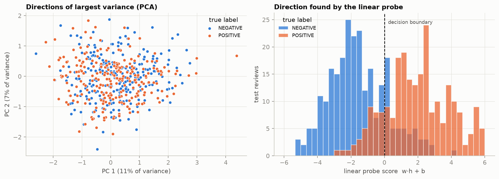
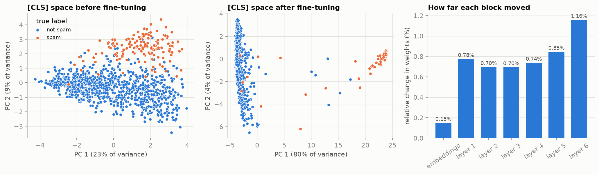
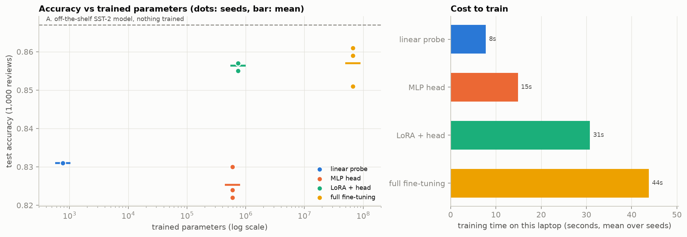

# Generative AI, from first principles

Notebooks I worked through while studying generative AI, written up the way I wish they had been taught: every exercise runs end to end, and next to the code I derive the math it depends on, check that math numerically, and test the claims with small experiments.

The exercises start from course material. The derivations, baselines, significance tests, figures and the comparison experiments are my own additions.

## Learning path

| # | Notebook | What it covers |
|---|---|---|
| 1 | [Generating one token at a time](1-generating-one-token-at-a-time.ipynb) | Tokenization, logits, softmax over a vocabulary, greedy decoding with GPT-2 |
| 2 | [Classification of handwritten digits using an MLP](2-classification-of-handwritten-digits-using-an-mlp.ipynb) | A first classifier on MNIST with scikit-learn |
| 2.1 | [MultiLayerPerceptron](2.1-MultiLayerPerceptron.ipynb) | Forward pass, MSE, and backpropagation of a two-layer MLP worked by hand and verified in PyTorch |
| 2.2 | [Sentiment analysis with a transformer](2.2-sentimentAnalysis-transfromer.ipynb) | WordPiece tokens and an off-the-shelf DistilBERT sentiment model on IMDB |
| 3 | [PyTorch and Hugging Face scavenger hunt](3-pytorch-and-hugging-face-scavenger-huntscavenger-hunt.ipynb) | Tensors, `torch.nn`, losses, optimizers, the training loop, models and datasets from the Hub |
| 3.1 | [Transfer learning using MobileNetV3](3.1-transfer-learning-using-mobilenetv3.ipynb) | Freezing a vision backbone and training a new head; depthwise-separable convolutions and squeeze-and-excitation |
| 4 | [Create a BERT sentiment classifier](4-create-a-bert-sentiment-classifier.ipynb) | What a classifier is (risk, Bayes classifier, surrogate losses), DistilBERT's math and parameter count, a frozen backbone with a trained head, probing |
| 4.1 | [Full fine-tuning BERT](4.1-full-fine-tuning-bert.ipynb) | Updating every weight on SMS spam; baselines, evaluation under class imbalance, McNemar's test, what fine-tuning changes inside the model |
| 4.2 | [Linear probe vs full fine-tuning vs LoRA](4.2-linear-probe-vs-full-fine-tuning-vs-lora.ipynb) | One controlled experiment over five adaptation regimes and three seeds, with LoRA implemented from scratch |

The notebooks build on each other. The softmax from 1 is the classifier output in 4. The MLP derived by hand in 2.1 is the classification head in 4. The freeze-and-train-a-head recipe from 3.1 is repeated for text in 4, removed in 4.1, and compared against its alternatives in 4.2.

## Adapting a pre-trained transformer: what I found

Notebooks 4 to 4.2 form one study of a single question: when you put a classifier on top of a pre-trained encoder, **which weights should you train?**

### 1. The task direction can be invisible and still be linearly decodable

On IMDB, the top principal components of frozen DistilBERT `[CLS]` vectors carry no sentiment signal. A logistic-regression probe nevertheless finds a direction, holding about 1% of the feature variance, that separates the classes at 82% accuracy. Judging a representation by a 2-D PCA plot would have missed it entirely. ([notebook 4](4-create-a-bert-sentiment-classifier.ipynb))



### 2. Full fine-tuning is not automatically the best option

On SMS spam, fine-tuning all 67M parameters reached 98.7% accuracy. A 769-parameter linear probe on the *frozen* model reached 99.3%, and its errors were a subset of the fine-tuned model's. Under a paired McNemar test, fine-tuning was not significantly better than a TF-IDF bag of words either. The reason shows up in the geometry: spam was already separated in the pre-trained space, so there was little for fine-tuning to add. What fine-tuning did do was collapse the representation onto the task, with a change of only about 1% in the weights. ([notebook 4.1](4.1-full-fine-tuning-bert.ipynb))



### 3. Where the trainable parameters sit matters more than how many there are

Holding data, epochs and seeds fixed on IMDB:

| Regime | Trained parameters | Test accuracy |
|---|---:|---:|
| Off-the-shelf SST-2 model, nothing trained | 0 | 86.7% |
| Linear probe on frozen features | 769 | 83.1% |
| Frozen backbone, MLP head | 592,130 | 82.5% ± 0.4 |
| LoRA (rank 8) + head | 739,586 | 85.6% ± 0.1 |
| Full fine-tuning | 66,955,010 | 85.7% ± 0.5 |

LoRA matched full fine-tuning with 1.1% of the parameters. Making the head on a frozen backbone 770 times larger bought nothing. And the best model was one already fine-tuned by someone else on more data from a neighbouring domain. ([notebook 4.2](4.2-linear-probe-vs-full-fine-tuning-vs-lora.ipynb))



Each notebook ends with a section on how the same pattern is used in production (classifier probes at Anthropic, BERT in Google Search and Bing, spam filtering in Gmail, content moderation at Meta and OpenAI, embeddings from Netflix's recommendation foundation model), with references, and a limitations section saying what the experiment does not show.

## Running the notebooks

Tested with Python 3.13 on an Apple Silicon Mac (MPS). The pinned versions are in `requirements.txt`.

```bash
python3.13 -m venv .venv
.venv/bin/pip install -r requirements.txt
.venv/bin/jupyter lab
```

Notebooks 4 to 4.2 each run in a few minutes on a laptop. Datasets and model weights download from the Hugging Face Hub on first use. Training checkpoints are written to `data/`, which is ignored by git.

Notes for current library versions:

- Hub ids need a namespace, for example `stanfordnlp/imdb` and `distilbert/distilbert-base-uncased`.
- `TrainingArguments(evaluation_strategy=...)` is now `eval_strategy`, and `Trainer(tokenizer=...)` is now `processing_class`.
- On MPS, DistilBERT needs `attn_implementation="eager"` for training, because the fused attention kernel does not support dropout there.
- Notebook 2 uses `torchviz`, which additionally needs the Graphviz system package.

## What comes next

- LP-FT (probe first, then fine-tune) with out-of-distribution evaluation
- Data-efficiency curves for each adaptation regime
- A rank sweep for LoRA
- The same from-scratch LoRA applied to a generative model, connecting back to notebook 1
